<div align="center">


# TrangPDF

**A calm, private PDF editor that runs entirely on your device.**

Read, organise, merge and save PDFs in the browser. No uploads, no account, no server.


</div>

<br />

<p align="center">
  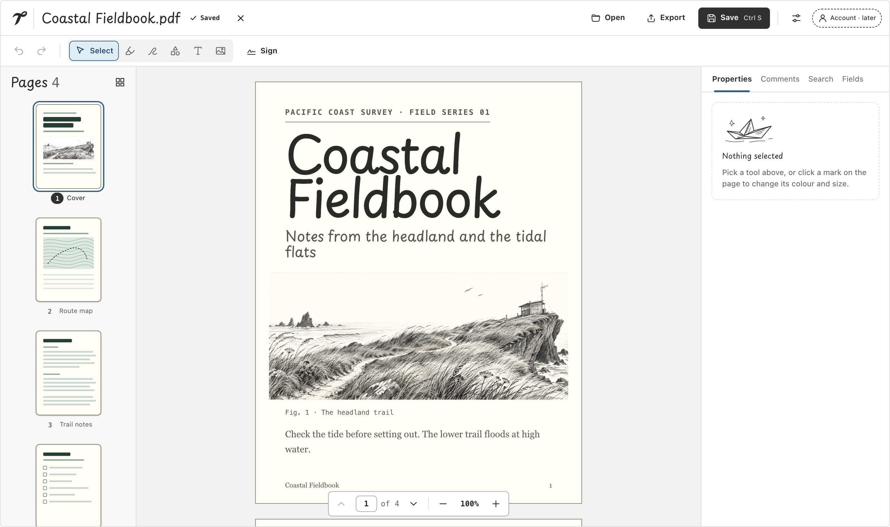
  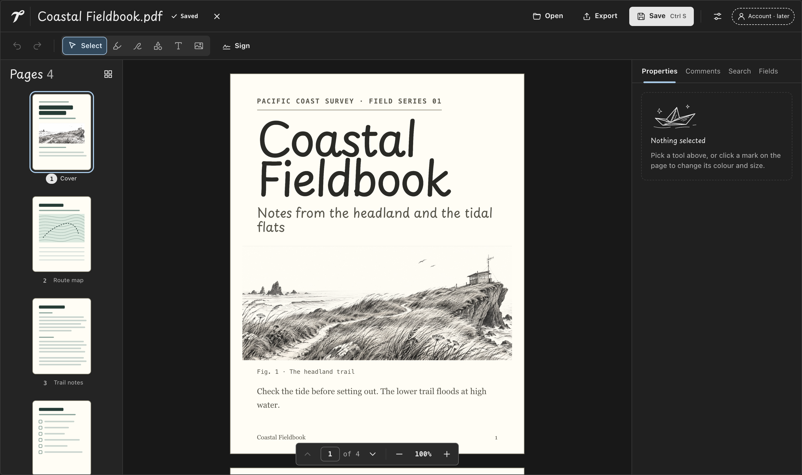
</p>

> [!NOTE]
> The screens in this README are from the approved design. They will be replaced with screenshots of the app once the web platform is finished.

## Contents

- [Why TrangPDF](#why-trangpdf)
- [Features](#features)
- [Design](#design)
- [Tech stack](#tech-stack)
- [Architecture](#architecture)
- [Getting started](#getting-started)
- [Keyboard shortcuts](#keyboard-shortcuts)
- [Testing](#testing)
- [Roadmap](#roadmap)

## Why TrangPDF

Most PDF tools ask you to upload a file before you can rotate a page. TrangPDF does the work where the file already is.

- **Private by design.** Files are read and written on your device. Nothing is sent anywhere.
- **The real engine.** Rendering and saving use PDFium, the same library that powers Chrome's PDF viewer, compiled to WebAssembly.
- **Safe to experiment.** Every edit can be undone, and a save is checked by reopening the result before it reaches your disk.
- **One codebase, many shells.** The editor is a set of platform-free packages, so the same code will power the desktop and mobile apps.

## Features

### Viewer

- Open by picker, drag and drop anywhere on the window, or from the recent files list.
- Smooth, virtualised scrolling that stays fast on documents with hundreds of pages.
- Crisp rendering at any zoom: fit width, fit page, or 50% to 400% presets, sharp on high-density screens.
- Page thumbnails, a page jump control, and the current page kept in view as you zoom.
- Password-protected files open after you enter the password, and stay encrypted when saved.
- Clear messages for damaged files, files that are not PDFs, and files over 500 MB.

### Page tools

- An organise view with a grid of every page.
- Click to select, click again to unselect, `Ctrl/⌘ A` to select all.
- Drag pages to reorder them, by mouse, touch or keyboard.
- Rotate, delete and extract selected pages.
- Insert pages from another PDF at any position to merge files.
- Undo and redo for every change, with an Undo button on each confirmation.

### Saving

- **Save** writes back to the same file where the browser allows it (File System Access API).
- **Save as** picks a new name and location, with a download fallback in every other browser.
- A prompt before closing a document or the tab while there are unsaved changes.

### Everywhere

- Light and dark themes that follow the system, or can be set by hand.
- A wide layout for desktop and a narrow layout for phones.
- Keyboard access and visible focus throughout.

## Design

The interface is a "sketchbook": quiet neutral surfaces, a single hand-lettered typeface, and paper that looks like paper.

<table>
  <tr>
    <td width="50%">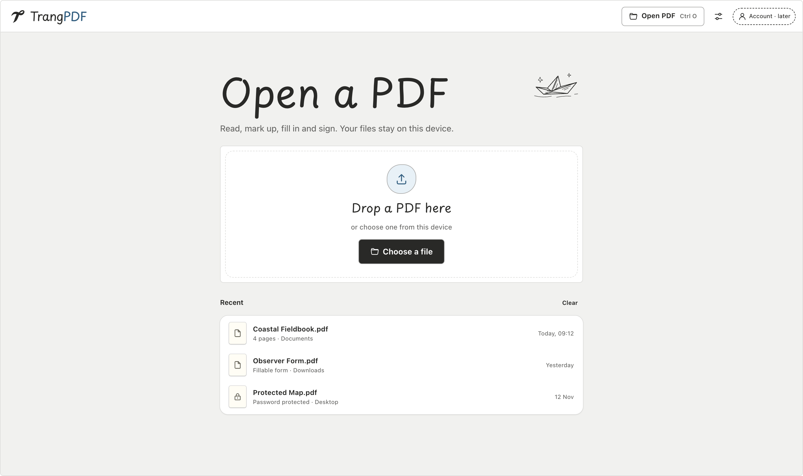</td>
    <td width="50%">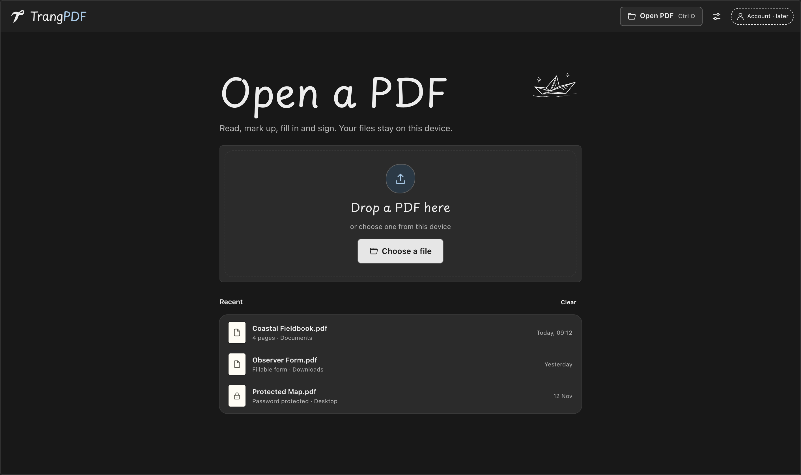</td>
  </tr>
  <tr>
    <td align="center"><sub><b>Start</b>: drop a file or pick a recent one</sub></td>
    <td align="center"><sub><b>Start</b>, dark theme</sub></td>
  </tr>
  <tr>
    <td>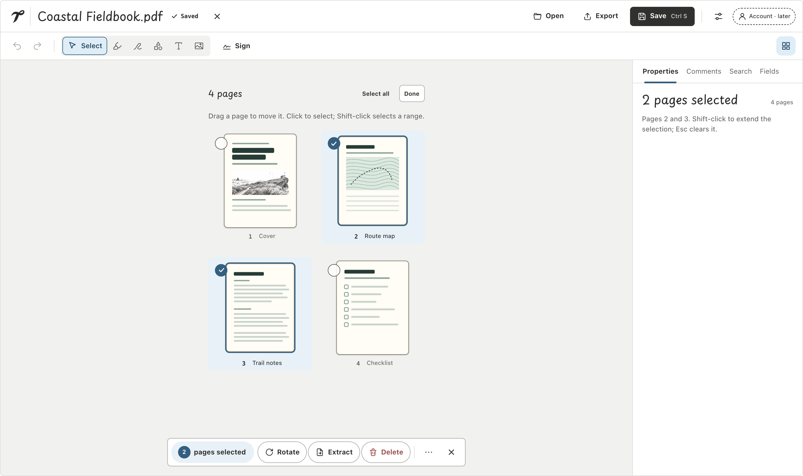</td>
    <td>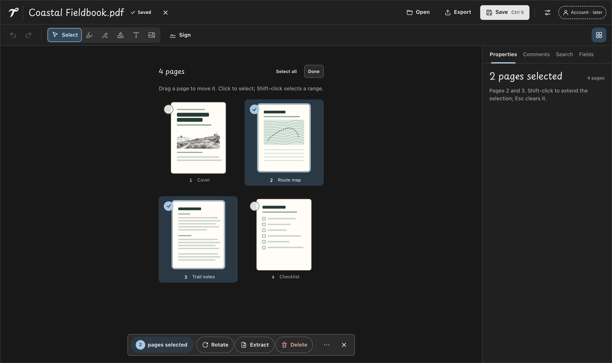</td>
  </tr>
  <tr>
    <td align="center"><sub><b>Organise</b>: select, rotate, extract, delete</sub></td>
    <td align="center"><sub><b>Organise</b>, dark theme</sub></td>
  </tr>
  <tr>
    <td>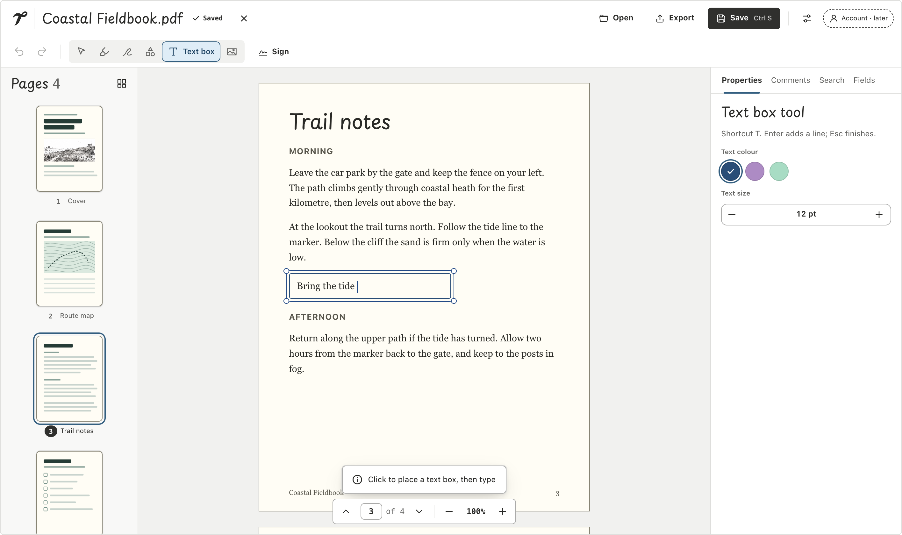</td>
    <td>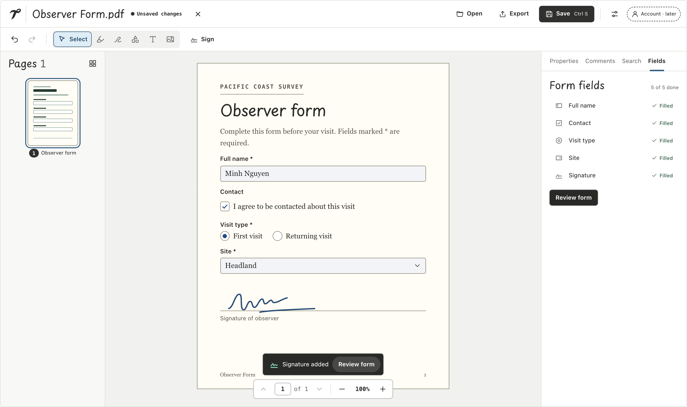</td>
  </tr>
  <tr>
    <td align="center"><sub><b>Annotate</b>: highlight from a text selection (coming)</sub></td>
    <td align="center"><sub><b>Fill and sign</b> (coming)</sub></td>
  </tr>
  <tr>
    <td>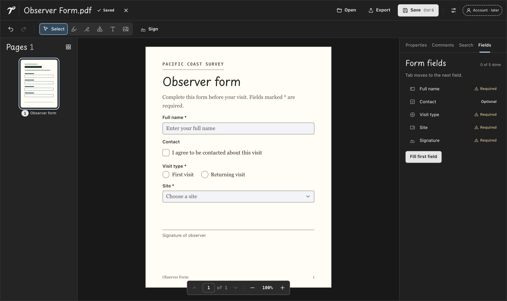</td>
    <td>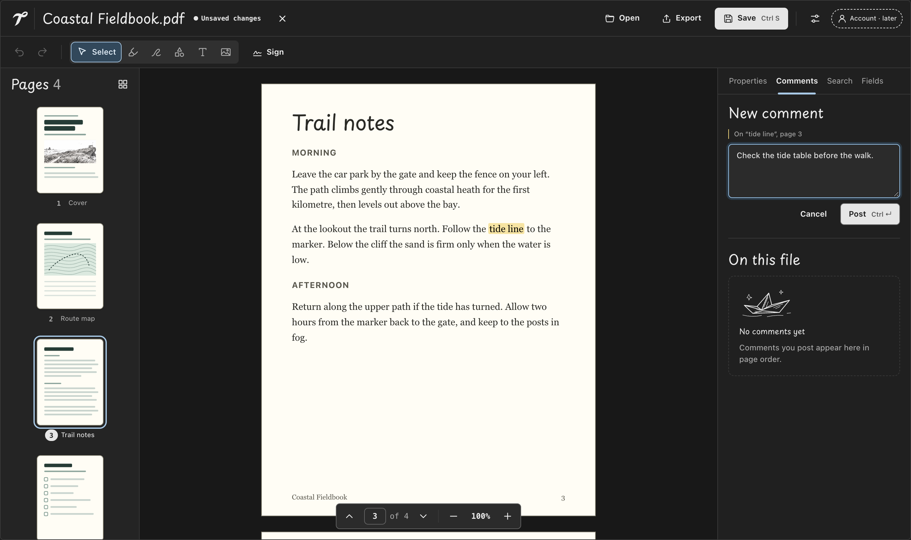</td>
  </tr>
  <tr>
    <td align="center"><sub><b>Forms</b> (coming)</sub></td>
    <td align="center"><sub><b>Comments</b> (coming)</sub></td>
  </tr>
</table>

<p align="center">
  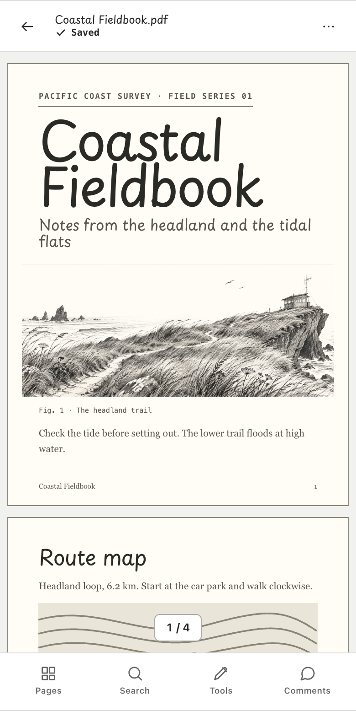
  &nbsp;
  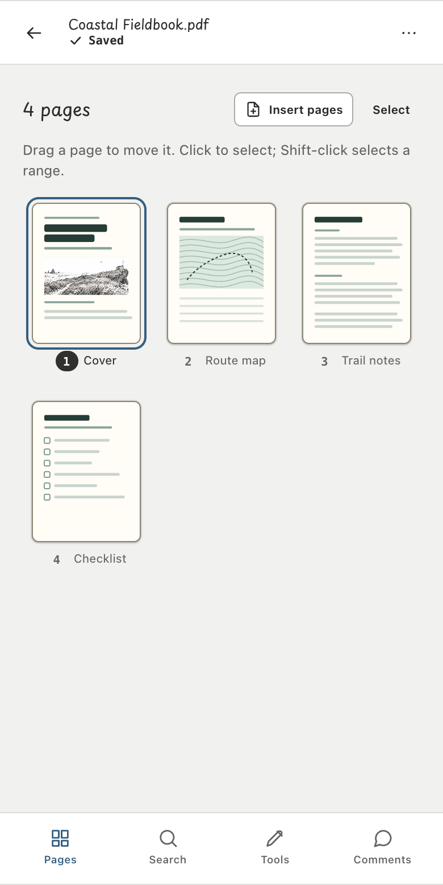
  &nbsp;
  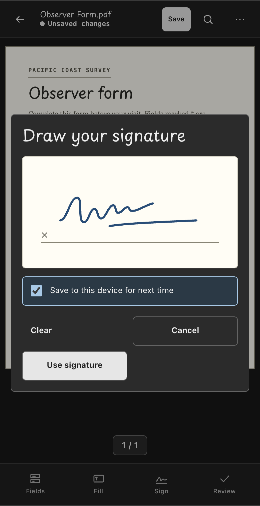
</p>
<p align="center"><sub>The narrow layout: reading, organising, and signing on a phone</sub></p>

|              |                                                                                                                                                       |
| ------------ | ----------------------------------------------------------------------------------------------------------------------------------------------------- |
| **Typeface** | [Playpen Sans](https://fonts.google.com/specimen/Playpen+Sans), a variable handwriting face with wide script coverage, self-hosted through Fontsource |
| **Palette**  | Neutral greys with ink-dark actions. Colour is kept for meaning, never decoration                                                                     |
| **Tokens**   | Three layers: primitives → semantic roles → components, all CSS custom properties exposed to Tailwind                                                 |
| **Themes**   | Light and dark, chosen by the system or by hand, applied before first paint to avoid a flash                                                          |
| **Icons**    | [Lucide](https://lucide.dev), stroke icons matched to the hand-drawn weight                                                                           |
| **Motion**   | Short and calm: under 300 ms except sheets and toasts, and off when reduced motion is requested                                                       |

## Tech stack

| Area                | Choice                                                                                               | Why                                                          |
| ------------------- | ---------------------------------------------------------------------------------------------------- | ------------------------------------------------------------ |
| Runtime and tooling | [Bun](https://bun.sh) workspaces                                                                     | One fast tool for installs, scripts, tests and type checking |
| UI                  | [React 19](https://react.dev)                                                                        | Components, concurrent rendering, StrictMode safety          |
| Language            | [TypeScript](https://www.typescriptlang.org), strict                                                 | Typed boundaries between every layer                         |
| Build               | [Vite 8](https://vite.dev)                                                                           | Dev server with HMR, worker and WebAssembly bundling         |
| Styling             | [Tailwind CSS 4](https://tailwindcss.com)                                                            | Utility classes generated from the design tokens             |
| PDF engine          | [PDFium](https://pdfium.googlesource.com/pdfium/) via [`@embedpdf/pdfium`](https://www.embedpdf.com) | Rendering, page assembly, encryption, in WebAssembly         |
| Concurrency         | Web Worker                                                                                           | The engine never blocks the interface                        |
| State               | [Zustand](https://zustand.docs.pmnd.rs)                                                              | A framework-free store in the core, React bindings in the UI |
| Drag and drop       | [dnd-kit](https://dndkit.com)                                                                        | Accessible sorting by mouse, touch and keyboard              |
| Icons               | [lucide-react](https://lucide.dev)                                                                   | Consistent, tree-shaken SVG icons                            |
| Font                | [Playpen Sans](https://fontsource.org/fonts/playpen-sans) via Fontsource                             | Self-hosted, no font CDN                                     |
| Tests               | `bun test` + [fast-check](https://fast-check.dev)                                                    | Unit tests and property-based tests                          |
| Linting             | [ESLint](https://eslint.org) with import boundaries                                                  | Keeps each layer from reaching into the wrong one            |

## Architecture

The code is split into layers. Each one may only depend on the layers below it, and ESLint enforces the rule.

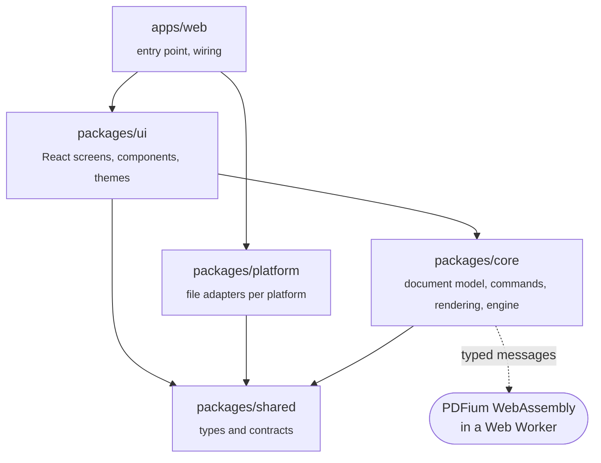

### How it works

- **Engine in a worker.** PDFium runs in a Web Worker behind a typed request and response protocol, with request ids and cancellation. The main thread only ever sees bitmaps and plain data.
- **Commands, not mutations.** Every edit (rotate, move, delete, insert) is a command with a pure `apply` and `undo` over an immutable document. History is two stacks, and "unsaved changes" means the top of the undo stack differs from the one that was saved.
- **Rendering pipeline.** Visible pages are rendered first by a cancellable queue, results are kept in a 256 MB LRU bitmap cache, and identical requests share one render.
- **Saving.** PDFium assembles the new file from the original bytes and any inserted documents, then the result is reopened to verify it before it is written.
- **Ports and adapters.** The editor talks to a `FileAdapter` interface. The web adapter uses the File System Access API with fallbacks. Desktop and mobile adapters will plug in the same way.

### Project structure

```text
.
├── apps/
│   └── web/                 Vite app: wires the engine, adapters and UI together
├── packages/
│   ├── core/src/
│   │   ├── document/        session, commands, history, selection
│   │   ├── engine/          PDFium worker, protocol, client
│   │   ├── render/          render queue, bitmap cache, page renderer
│   │   └── geometry/        zoom and page size maths
│   ├── platform/src/web/    File System Access adapter, recent files
│   ├── shared/src/          FileAdapter contract, PDF types, Result
│   └── ui/src/
│       ├── components/      start, viewer, organize, dialogs, primitives
│       ├── editor/          document actions, file opening, leave guard
│       ├── state/           viewer, toast and theme stores
│       └── themes/          design tokens and Tailwind theme
└── test-corpus/             sample PDFs: plain, encrypted, damaged, not a PDF
```

## Getting started

You need [Bun](https://bun.sh) 1.3 or newer.

```bash
bun install
bun run dev
```

Then open the address Vite prints, usually <http://localhost:5173>.

| Script              | What it does                             |
| ------------------- | ---------------------------------------- |
| `bun run dev`       | Start the web app with hot reload        |
| `bun run build`     | Build the web app for production         |
| `bun run typecheck` | Type check every package                 |
| `bun run lint`      | Lint, including the layer boundary rules |
| `bun run test`      | Run unit and property tests              |

> [!TIP]
> Saving back to the same file needs the File System Access API (Chrome, Edge and other Chromium browsers). In other browsers, Save downloads a copy instead.

## Keyboard shortcuts

| Action                             | macOS                                 | Windows and Linux          |
| ---------------------------------- | ------------------------------------- | -------------------------- |
| Open a file                        | `⌘ O`                                 | `Ctrl O`                   |
| Save                               | `⌘ S`                                 | `Ctrl S`                   |
| Save as                            | `⇧ ⌘ S`                               | `Ctrl Shift S`             |
| Undo                               | `⌘ Z`                                 | `Ctrl Z`                   |
| Redo                               | `⇧ ⌘ Z`                               | `Ctrl Y` or `Ctrl Shift Z` |
| Select all pages                   | `⌘ A`                                 | `Ctrl A`                   |
| Delete selected pages              | `Delete` or `⌫`                       | `Delete` or `Backspace`    |
| Pick up and drop a page            | `M`, then arrows, then `M` or `Enter` | same                       |
| Clear selection, or leave organise | `Esc`                                 | `Esc`                      |

## Testing

```bash
bun run test
```

- **Unit tests** cover commands, history, selection, zoom maths, the render queue, the bitmap cache and file validation.
- **Property tests** with fast-check run random sequences of edits and check that undoing all of them returns the exact starting document.
- **Test corpus** in `test-corpus/` holds small PDFs for the awkward cases: encrypted, damaged, and files that only pretend to be PDFs.

## Roadmap

- [x] **Phase 0: Setup.** Workspaces, engine running in a worker
- [x] **Phase 1: Viewer.** Open, render, zoom, navigate, passwords, recent files
- [x] **Phase 2: Page tools.** Reorder, rotate, delete, insert, extract, undo, save
- [ ] **Phase 3: Annotations, comments and forms**
  - [x] Highlight from a text selection, freehand drawing, rectangles, colour and size properties, undo
  - [x] Edit the page's own text in place (click, retype, drag to move), add new page text
  - [x] Several files open in tabs, command palette (search text, run commands, switch files), collapsible sidebars
  - [x] Every markup is a comment, Acrobat style: threads with replies, a Comments panel grouped by page
  - [ ] The full markup set: underline, strikethrough, squiggly, sticky notes; ellipse, line and arrow shapes
  - [x] Redesigned shell: menu bar (File, Edit, View, Tools, Pages), files in their own tab row, a tool palette you drag anywhere and turn flat or upright, tools visible at every width
  - [x] Phone layout: file switcher, bottom bar, floating tools
  - [ ] Images, drawn signatures saved on the device, form filling, flatten on export
  - [ ] Matching fonts for edited text (bundled open look-alikes, fonts installed on the device)
- [ ] **Phase 4: Desktop app.** Tauri 2, open PDFs from the system, save in place, auto-updates
- [ ] **Phase 5: Mobile app.** Capacitor, share sheet, touch gestures, bottom sheets
- [ ] **Phase 6: Sync and paid tier.** Accounts, document sync, OCR
- [ ] **Phase 7: Advanced.** True redaction, compression, certificate signatures, conversion

## Acknowledgements

- [PDFium](https://pdfium.googlesource.com/pdfium/) and [EmbedPDF](https://www.embedpdf.com) for the WebAssembly build.
- [Playpen Sans](https://github.com/TypeTogether/Playpen-Sans) by TypeTogether, under the SIL Open Font License.
- [Lucide](https://lucide.dev) icons, under the ISC License.
